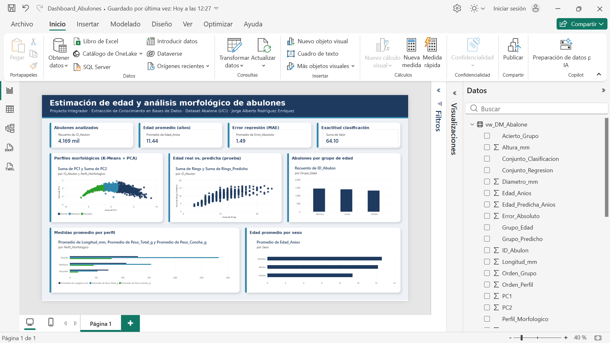

# REC_ECBD_2026_Rodriguez_Jorge

**Asignatura:** Extracción de Conocimiento en Bases de Datos (Recursamiento 2026)

**Estudiante:** Jorge Alberto Rodríguez Enríquez — 9 IDGS G2, UTTT

**Proyecto:** Estimación de edad y análisis morfológico de abulones

## Descripción del proyecto
Actualmente la edad de un abulón se determina cortando su concha, tiñéndola y contando sus anillos con un microscopio, un proceso lento y que requiere laboratorio. Este proyecto busca estimar la edad del abulón a partir de medidas físicas fáciles de obtener (sexo, dimensiones y pesos), clasificarlo por grupo de edad e identificar perfiles morfológicos.

**Pregunta principal:** ¿En qué medida las características físicas del abulón (sexo, dimensiones y pesos) permiten estimar su edad y reconocer perfiles o etapas de crecimiento?

## Dataset
- **Nombre:** Abalone
- **Fuente:** UCI Machine Learning Repository — https://archive.ics.uci.edu/dataset/1/abalone
- **Cita:** Nash, W., Sellers, T., Talbot, S., Cawthorn, A., & Ford, W. (1994). Abalone [Dataset]. https://doi.org/10.24432/C55C7W
- **Tamaño:** 4,177 registros, 8 variables + 1 variable objetivo (Rings)
- **Licencia:** CC BY 4.0

## Forma de trabajo
- **Metodología:** CRISP-DM (6 fases), aplicada a lo largo de las 5 unidades.
- **Herramientas:** Python 3, Jupyter/VS Code, Pandas, NumPy, scikit-learn, Matplotlib, SQL Server, Power BI, Git/GitHub.
- **Regla de datos:** `data/raw` conserva el original sin modificar; los datos limpios van en `data/processed`.
- **Regresión:** predecir `Rings` (edad ≈ Rings + 1.5 años).
- **Clasificación:** Grupo_Edad → Joven (Rings ≤ 8), Adulto (9–10), Maduro (≥ 11).
- **No supervisado:** K-Means + PCA sobre las medidas físicas.
- **Entregas:** los documentos de cada unidad se guardan en `docs/`.

## Unidad II — Actividad de Evaluación 1: Exploración y diagnóstico
| Archivo | Contenido |
|---|---|
| `notebooks/Rodriguez_Enriquez_Jorge_Alberto_U2_AE1_Exploracion.ipynb` | Carga, `head/shape/columns/info/dtypes/describe`, diccionario de datos, tipo y fuente, faltantes, duplicados, inconsistencias, estadística, boxplots, visualizaciones y propuestas de análisis (sin modificar los datos) |
| `docs/Rodriguez_Enriquez_Jorge_Alberto_U2_AE1_Diagnostico.pdf` | Informe de diagnóstico |
| `docs/figuras/ae1_*.png` | Gráficas generadas por el notebook |

**Diagnóstico:** 4,177 registros, 9 variables, sin faltantes ni duplicados; menos del 0.3% de registros con valores físicamente imposibles (alturas en 0 o extremas, partes que pesan más que el total).

## Unidad II — Preparación de datos
| Archivo | Contenido |
|---|---|
| `notebooks/01_carga_y_diccionario.ipynb` | Carga del dataset y diccionario de datos (`docs/diccionario_datos.csv`) |
| `notebooks/02_analisis_exploratorio.ipynb` | EDA: estadísticas, gráficas (`docs/figuras/`), atípicos y correlaciones |
| `notebooks/03_limpieza_etl.ipynb` | ETL: elimina 8 registros físicamente imposibles, crea unidades reales, `Edad_anios`, `Grupo_Edad` e ID → `data/processed/abalone_limpio.csv` (4,169 registros) |
| Data Warehouse y ETL | Ver la sección **Data Warehouse, ETL automático y Data Mart** |
| `docs/figuras/11_*`, `12_*`, `13_*` | Evidencias de ejecución en SQL Server 2025 Express (4,169 registros cargados en `Fact_Abulon`) |

## Unidad III — Análisis supervisado
| Archivo | Contenido |
|---|---|
| `notebooks/04_regresion.ipynb` | Predice `Rings` con regresión lineal, árbol de decisión y Random Forest; optimización con GridSearchCV |
| `notebooks/05_clasificacion.ipynb` | Clasifica `Grupo_Edad` con regresión logística, KNN y Random Forest; matriz de confusión |
| `docs/metricas_regresion.csv`, `docs/metricas_clasificacion.csv` | Métricas de comparación |
| `modelos/*.joblib` | Modelos optimizados guardados |

**Resultados principales:** regresión → Random Forest optimizado con MAE ≈ 1.49 anillos y R² ≈ 0.61 (baseline MAE ≈ 2.52). Clasificación → exactitud ≈ 64% (azar = 33%); la clase Adulto es la más difícil.

## Unidad IV — Análisis no supervisado
| Archivo | Contenido |
|---|---|
| `notebooks/06_no_supervisado.ipynb` | K-Means (método del codo y silueta, k = 3) y PCA; perfiles Pequeño / Mediano / Grande |
| `notebooks/07_predicciones_dashboard.ipynb` | Predicciones de los modelos por abulón (marcando Entrenamiento / Prueba) para el dashboard |
| `data/processed/abalone_clusters.csv`, `data/processed/abalone_predicciones.csv` | Resultados que se cargan al Data Warehouse |
| `docs/metricas_clustering.csv`, `docs/perfiles_clusters.csv` | Métricas y perfiles |
| `modelos/kmeans_pca.joblib` | Modelo K-Means + PCA guardado |

**Resultados:** 3 perfiles morfológicos (silueta 0.44). Sin conocer la edad, el perfil Pequeño es 71% infantes y el Grande 58% maduros. PC1 (tamaño general) concentra el 92.5% de la información de las 7 medidas.

## Data Warehouse, ETL automático y Data Mart
| Archivo | Contenido |
|---|---|
| `sql/01_crear_datamart.sql` | Crea el **esquema estrella**: `Dim_Tiempo`, `Dim_Sexo`, `Dim_Grupo_Edad`, `Fact_Abulon`, tablas de resultados (`Res_Cluster`, `Res_Prediccion`, `Res_Metrica_Modelo`), bitácora `Log_ETL` y el procedimiento **`sp_Generar_Dim_Tiempo`** |
| `src/etl_abalone.py` | **ETL automático con carga FULL**: extrae de `data/raw`, transforma, aplica los modelos y carga todo en SQL Server |
| `sql/02_vistas_datamart.sql` | **Data Mart** como vistas: `vw_DM_Abalone`, `vw_DM_Resumen_Perfil`, `vw_DM_Desempeno_Modelos`, `vw_DM_Comparacion_Modelos` |
| `sql/03_consultas_validacion.sql` | Conteos, bitácora del ETL y consultas por mes |
| `docs/figuras/21_diagrama_esquema_estrella.png` | Diagrama del esquema estrella |
| `dashboard/` | Dashboard de Power BI conectado a las vistas del Data Mart |

**Orden de ejecución:** notebooks 01 → 07 (exploración y entrenamiento de modelos) → `sql/01` (una vez) → `python src/etl_abalone.py` → `sql/02` → Power BI (Inicio → Actualizar).

> El dataset original no tiene fechas, por lo que el ETL asigna a cada abulón una **fecha de muestreo simulada** (días hábiles de enero a diciembre de 2026, con semilla fija). `Dim_Tiempo` se genera con un procedimiento almacenado de 2026 a 2035.



## Cómo ejecutar el proyecto
```
python -m venv .venv
.venv\Scripts\activate
pip install -r requirements.txt
```
Después ejecutar los notebooks en orden (kernel `.venv`), crear el Data Warehouse con `sql/01_crear_datamart.sql` en SSMS, correr el ETL con `python src/etl_abalone.py` y crear las vistas con `sql/02_vistas_datamart.sql`.

## Estructura del repositorio
- `data/raw/` — datos originales sin modificar
- `data/processed/` — datos limpios y transformados
- `notebooks/` — análisis en Jupyter
- `src/` — scripts de Python
- `sql/` — scripts del Data Warehouse / Data Mart
- `modelos/` — modelos entrenados
- `dashboard/` — dashboard en Power BI
- `docs/` — documentos y entregas

## Avance
- [x] Actividad 0 — Inicio y registro
- [x] Unidad I — Planeación del proyecto
- [x] Unidad II — Preparación de datos (notebooks 01–03 y Data Mart probado en SQL Server)
- [x] Unidad III — Análisis supervisado (regresión y clasificación con entrenamiento/prueba)
- [x] Unidad IV — Análisis no supervisado (K-Means + PCA)
- [x] Unidad V — Dashboard en Power BI conectado al Data Mart de SQL Server
